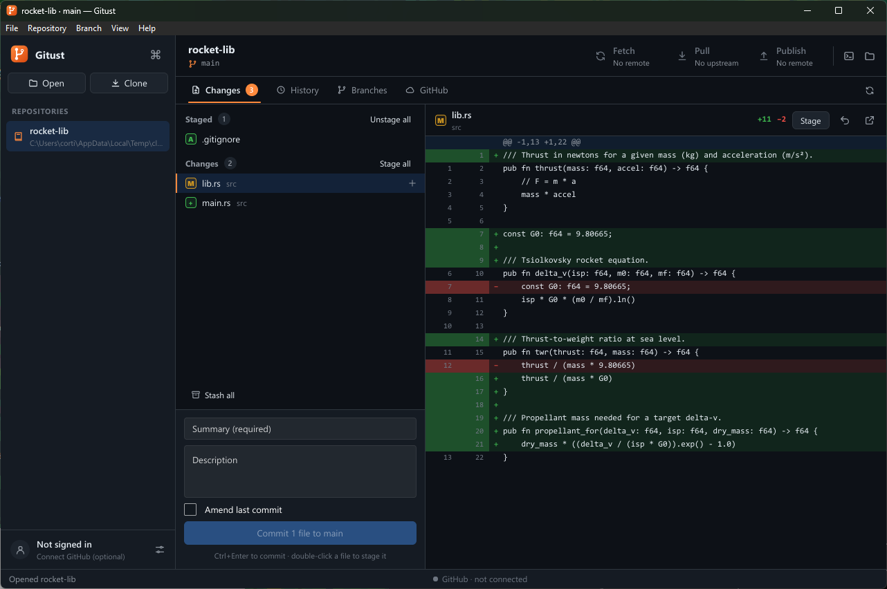
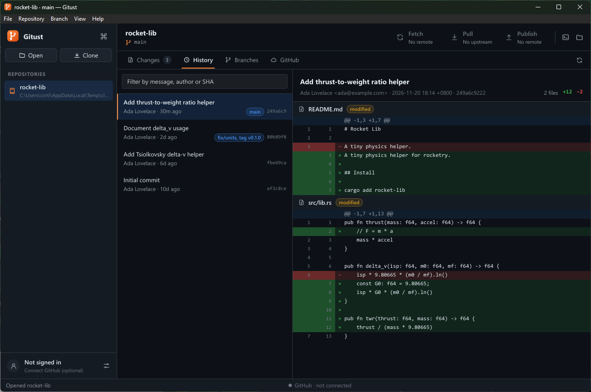

<p align="center"></p>

<h1 align="center">Gitust</h1>

<p align="center"><b>A tiny, performant, 100% native Git &amp; GitHub desktop client, written in Rust.</b><br>
No Electron, no webview, no Node runtime: one small executable.</p>

<p align="center">
  
  
</p>

## Why

GitHub Desktop is pleasant but it ships a browser. Gitust keeps the same everyday flow (see what changed, stage, commit, branch, push) in a native [Slint](https://slint.dev) window that starts fast and idles at ~0% CPU. GitHub is optional: everything local works offline with no account.

## Features

**Local Git (works offline, no sign-in)**
- Open any repository (or `gitust <path>` from a terminal), pinned and recent repositories
- Staged / unstaged / untracked / conflicted files, kept live by a debounced, ignore-aware file watcher
- Fast diffs with line numbers, tab expansion, binary detection, large-file guard (3 MB) and 5,000-line cap
- Conflict view with *ours* / *theirs* regions tinted and marker lines highlighted
- Stage / unstage per file or all, double-click to stage, discard with confirmation
- Commit with summary + description, 72-char hint, **Ctrl+Enter** from anywhere, amend (with a warning if the commit is already pushed)
- History with branch/tag decorations, unpushed markers, incremental loading, filter by message/author/SHA, full commit detail and multi-file diff
- Branches: local + remote, ahead/behind, switch (tracks remote branches automatically), create, merge, delete (safe `-d` only), revert commits
- Stash all (including untracked) / pop
- Fetch, pull, push / publish branch with live progress and **cancel**
- Clone by URL or `owner/name`, with progress
- Plain-English error explanations (auth, diverged branches, conflicts, rejected pushes, missing identity…), with the raw Git output one click away

**GitHub (optional)**
- Sign in with your existing **GitHub CLI** session, a **personal access token**, or the **OAuth device flow**
- Tokens live in the OS credential vault (Windows Credential Manager / macOS Keychain / Secret Service), never in plain files
- Browse your repositories (cached for instant, offline display) and clone or open them in one click
- Open pull requests and issues for the current repository or everything involving you; notifications inbox
- Open on GitHub, create a pull request from the current branch

**Workflow**
- Command palette (**Ctrl+P**): fuzzy-search commands, repositories, branches and your GitHub repos
- Native menu bar with shortcuts, right-click context menus
- Light / dark / follow-system theme; remembers window size, last repository and settings
- Opens your terminal or file manager at the repository

## Keyboard

| Action | Shortcut |
|---|---|
| Command palette | Ctrl+P |
| Commit | Ctrl+Enter |
| Fetch · Pull · Push | Ctrl+Shift+F · Ctrl+Shift+L · Ctrl+Shift+P |
| Stage all · Stash | Ctrl+Shift+A · Ctrl+Shift+S |
| New branch · Switch branch | Ctrl+B · Ctrl+Shift+B |
| Changes · History · Branches · GitHub | Ctrl+1 … Ctrl+4 |
| Refresh | F5 |
| Open repository · Clone | Ctrl+O · Ctrl+Shift+N |
| Terminal · File manager | Ctrl+\` · Ctrl+Shift+E |
| Open on GitHub · Create PR | Ctrl+Shift+G · Ctrl+Shift+R |
| Settings | Ctrl+, |

## Performance

Measured with [`scripts/bench.ps1`](scripts/bench.ps1) (release build, small repository, isolated data dir):

| Measure | Plan budget | Small repo | Large repo¹ |
|---|---|---|---|
| Release binary | — | 16.2 MB, single file | |
| Window visible after launch | < 1 s | 30 ms (158 ms first cold run) | 31 ms |
| Idle private memory | < 120 MB | **9.8 MB** | **11.7 MB** |
| Idle working set | — | 32 MB | 34 MB |
| Idle CPU (10 s) | ~0% | 0% | 0.08% |
| Working-tree status | < 500 ms | — | 70 ms (1,001 changed files) |
| First page of history (300) | — | — | 27 ms |

¹ Synthetic: 20,000 files, 5,000 commits, 1,001 modified files. Ryzen 7 5700X, 32 GB RAM, NVMe SSD, Windows 11. Git-layer timings from `GITUST_BENCH_REPO=<path> cargo test --release -- --ignored --nocapture bench_repo`.

The biggest single win is the renderer: Slint's software renderer produces identical output for this UI at ~10 MB of private memory, versus ~88 MB once an OpenGL context and GPU driver are loaded. If you prefer the GPU path (for example, a maximised 4K window), run with `SLINT_BACKEND=winit-femtovg`.

These are measurements on one machine, not promises. Run the script on yours.

How it stays light:
- The UI thread never touches Git, disk or network. Work runs on a 2-thread Tokio runtime plus a blocking pool; results are pushed to the UI as immutable snapshots, and stale results are dropped by sequence number.
- Nothing polls. The watcher ignores `.git` internals except the refs that matter, and skips any path Git ignores (so `cargo build` or `npm install` don't cause refresh storms). Refreshes coalesce.
- Lists are virtualised and models are updated in place, so scroll position survives refreshes.
- History walks by time (not topological order) so the first page of a huge repository arrives immediately.
- GitHub data loads only when its tab is visible and is reused for 3 minutes.

## Build

Requirements: Rust 1.88+, a C compiler (MSVC Build Tools on Windows; `cc` elsewhere) for the bundled libgit2 and SQLite, and **Git on PATH** at runtime.

```sh
cargo run --release              # or: cargo run --release -- path/to/repo
cargo test
```

Linux also needs `libfontconfig1-dev libxkbcommon-dev`.

### Enabling “Sign in with your browser” (device flow)

The device-flow button appears only when a GitHub OAuth App client ID is configured:

1. Create an OAuth App at **GitHub → Settings → Developer settings → OAuth Apps** (any homepage URL; callback URL unused).
2. Tick **Enable Device Flow**. No client secret is needed.
3. Build with `GITUST_GITHUB_CLIENT_ID=<client id> cargo build --release`, or set the same variable at runtime.

The other two sign-in methods (GitHub CLI session, personal access token) work without this.

## Architecture

```
Slint UI (ui/*.slint)  ── callbacks ──▶  App controller (src/app.rs)
   ▲  AppState global                         │
   └──── invoke_from_event_loop ◀─────────────┤
                                              ├─▶ git.rs     libgit2: status, diff, history, branches (read-mostly)
                                              ├─▶ cli.rs     installed git: commit, stage, fetch/pull/push/clone (argv only)
                                              ├─▶ github.rs  octocrab REST + OS keyring + device flow
                                              ├─▶ store.rs   SQLite: recents, settings, repo-list cache (migrations)
                                              └─▶ watch.rs   debounced, ignore-aware file watcher
```

Design rules:
- **Slint is only a view.** All state and decisions live in Rust; `ui/state.slint` is the single contract.
- **Mutations are serialised** per app through one async lock. Long operations refuse to overlap and can be cancelled; quick ones (stage/unstage) queue.
- **Local reads use libgit2; writes use the Git CLI.** Commits run your hooks and signing config, staging respects LFS and other filters, and network operations reuse your credential manager and SSH agent. Gitust never needs your Git password.
- **No shell strings, ever.** Git is invoked with an explicit argv; paths travel over stdin NUL-separated (`--pathspec-from-file`) with `GIT_LITERAL_PATHSPECS=1`.

## Security notes

- Repositories are treated as untrusted: "Open file" reveals executables and scripts in the file manager instead of running them, and only `http(s)` links are opened.
- Gitust never force-pushes, never hard-resets, and deletes branches only with `git branch -d` (refuses unmerged work). Discarding changes, merging, reverting and amending a pushed commit all ask first.
- `GIT_TERMINAL_PROMPT=0` prevents hidden prompts; GUI credential managers still work.
- Signing out deletes the token from the vault and clears cached GitHub data. Only repository metadata is cached; issue and PR contents are not stored.

## Data & configuration

| What | Where |
|---|---|
| Settings, recents, GitHub repo cache | `%APPDATA%\Gitust\gitust.db` · `~/Library/Application Support/Gitust` · `~/.local/share/Gitust` |
| GitHub token | OS credential vault, service `gitust` |
| `GITUST_DATA_DIR` | Override the data folder (portable installs, tests) |
| `GITUST_GITHUB_CLIENT_ID` | OAuth App client ID for device-flow sign-in |
| `SLINT_BACKEND` | e.g. `winit-femtovg` to use the OpenGL renderer instead of the default software renderer |

## Known limitations / next steps

- File-level staging only (no hunk or line staging yet)
- One GitHub account at a time; GitHub.com only (no Enterprise host setting)
- Opens your system terminal rather than embedding one
- No built-in merge editor: conflicts are shown and explained, resolution happens in your editor
- Developed and tested on Windows 11. The CI workflow targets Linux and macOS too, but neither has been built or tried yet
- No installer or auto-update yet; `cargo build --release` produces a single portable `.exe`

## License

Not chosen yet. Note that Slint is available under GPLv3, a royalty-free license for desktop apps (requires attribution), or a commercial license, so pick a project license that is compatible with the Slint option you use.
